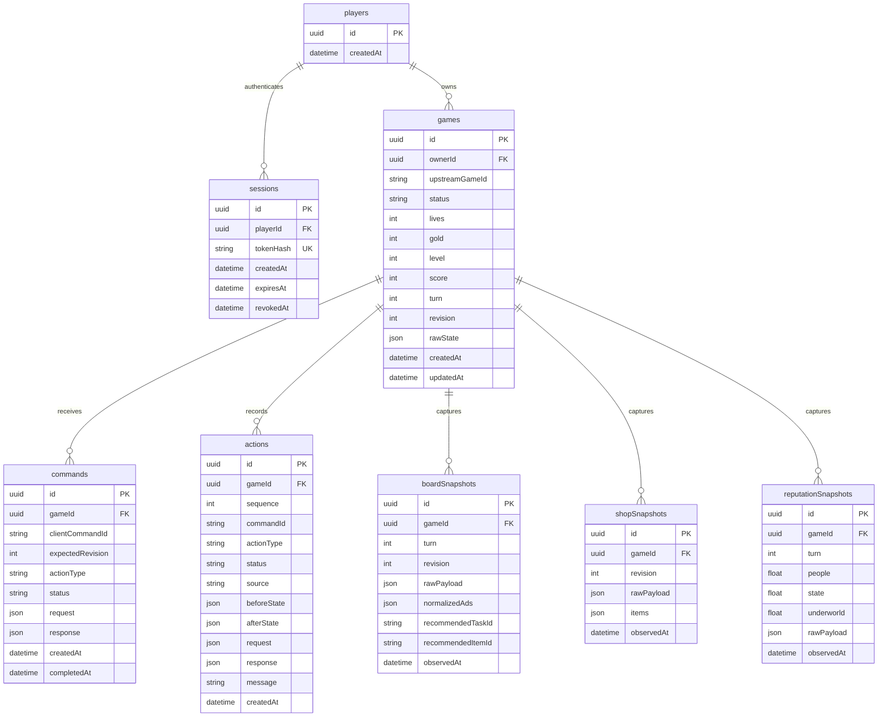

# Database schema

The Drizzle definitions in `packages/db/src/schema.ts` and their migrations are the source of truth. This Mermaid ER diagram is a maintained view of the same schema.

Deleting a game cascades to its commands, actions, and board, shop, and reputation snapshots.

Nullable columns are `sessions.revokedAt`, `commands.response`, `commands.completedAt`, `actions.afterState`, `actions.response`, `actions.message`, `boardSnapshots.recommendedTaskId`, `boardSnapshots.recommendedItemId`, and `reputationSnapshots.turn`. Composite unique constraints are `(commands.gameId, commands.clientCommandId)`, `(actions.gameId, actions.sequence)`, and `(actions.gameId, actions.commandId)`.

CLI manual and autoplay games are stored as game rows under an internal player owner. Their actions identify `manual` or `autoplay` as the source.

